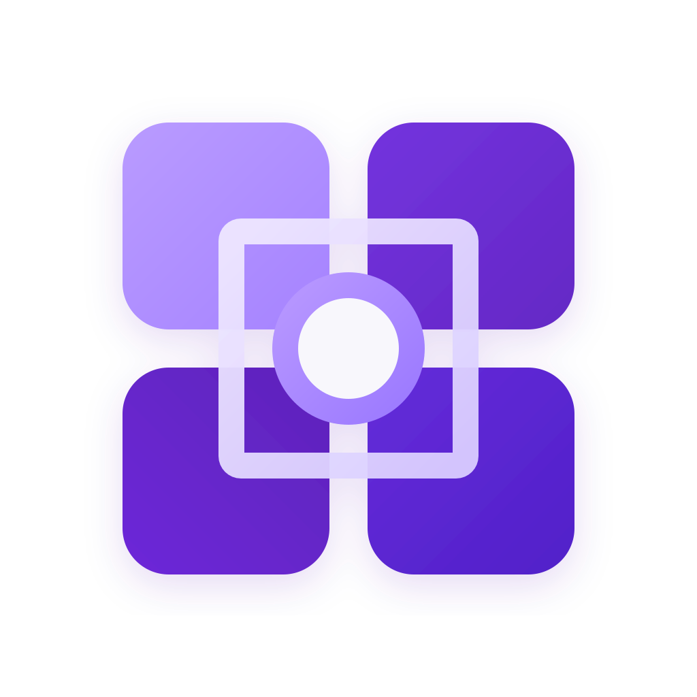

<p align="center">
  
</p>

<h1 align="center">KAORI Docs</h1>
<p align="center"><strong>Knowledge, Automation, Operations, Resilience &amp; Intelligence</strong></p>
<p align="center">Product documentation for the KAORI infrastructure operations platform.</p>

<p align="center">
  
  
  
</p>

**KAORI Docs** is the dedicated, static, read-only documentation project planned for [docs.kaori.cloud](https://docs.kaori.cloud). The [KAORI Website](https://kaori.cloud) introduces the product; the authenticated [KAORI Application](https://app.kaori.cloud) provides operational capabilities.

This repository contains **documentation only**. It does not authenticate users, connect to live infrastructure providers, or define product functionality or release acceptance. Product, design, and release authority remains in [OXY7O/KAORI](https://github.com/OXY7O/KAORI). A website or app deployment is not evidence that Docs has been published.

**Publication state:** The Docusaurus scaffold is in progress under [#11](https://github.com/OXY7O/kaori-docs/issues/11). No release-qualified product documentation or public Docs deployment is claimed. The minimal root page is a truthful preparation state, not the approved Documentation Home (#1).

## Technology and project structure

The project uses **Docusaurus 3, TypeScript 5, React, Node.js 22 and Inter**, with the existing KAORI Violet design principles. Docusaurus native theme and Infima tokens are preferred over a separate design system or custom router.

- `docusaurus.config.ts`, `sidebars.ts` — Docusaurus configuration and reserved native docs navigation.
- `src/pages/` — minimal static preparation page; approved Docs Home is owned by #1.
- `src/css/` — small KAORI Violet/Inter theme-token adaptation.
- `static/branding/` — approved KAORI logo reused from the Website.
- `content/` — reserved **public** Docusaurus article/version content; not enabled for public builds until #15 release mapping is approved.
- `docs/` — **internal repository engineering, delivery and authoring guidance**, not a public content source.
- `.devcontainer/`, `compose.dev.yml` — isolated Node.js development environment.
- `.github/` — canonical KAORI PR guidance; CI workflows are owned by #12.

Do not copy internal KAORI Application runbooks, credentials, operational identifiers, review artifacts or unpublished release claims into `content/`, `static/` or `src/pages/`.

## Get started

**Recommended:** open this repository in VS Code and select **Dev Containers: Reopen in Container**. The dedicated Compose workspace uses the `node` user and binds the local preview to loopback port `3000`.

Alternatively, install **Node.js 22** and **npm 10**:

```bash
npm ci
npm run dev
```

Open [http://localhost:3000](http://localhost:3000).

**Bootstrap validation:** A registry-resolved `package-lock.json` is committed in the combined #11/#12 review branch. The [self-hosted Developer Check run #41396567726](https://github.com/OXY7O/kaori-docs/actions/runs/41396567726) passed on SHA `f2e13e631c71fa416c6c2f1f95b2b3cea43f7e4c`, including `npm ci`, formatting, TypeScript, npm security audit and Docusaurus build. Every later change requires a **new exact-head** gate. Full Admission, browser/server UAT and human acceptance remain separate, unclaimed checks. See [development guidance](docs/DEVELOPMENT.md).

## Quality checks

Using the reviewed committed lockfile:

```bash
npm ci
npm run check-format
npm run check
npm run build
npm run serve
```

A complete acceptance requires actual Developer Check, browser light/dark/mobile/accessibility evidence, staging Full Admission, UAT and human approval at their respective phases. Local source inspection is not a build or release PASS.

## Documentation

- [Architecture and public-content boundary](docs/ARCHITECTURE.md)
- [Development and Dev Container](docs/DEVELOPMENT.md)
- [Public authoring and content safety](docs/CONTENT_SAFETY.md)
- [Governed delivery](docs/DELIVERY.md)
- [CI/CD and quality gates](docs/CI_CD.md)
- [KAORI product authority](https://github.com/OXY7O/KAORI/blob/main/docs/product/README.md)
- [KAORI Design System](https://github.com/OXY7O/KAORI/blob/main/docs/design/KAORI_DESIGN_SYSTEM.md)

The Docs Home (#1), introductory article (#2), version mapping (#15), local search (#16), CI (#12), immutable publisher (#13), and deployment adapter (#14) are separate issue-owned workstreams.

## Security and ownership

This repository is private and maintained under KAORI issue-linked delivery governance. Public output must contain only reviewed, release-authorized content. Do not commit secrets, internal endpoints, hostnames, private inventory or operational evidence. No release badge is displayed until an actual signed Docs release has been verified.
